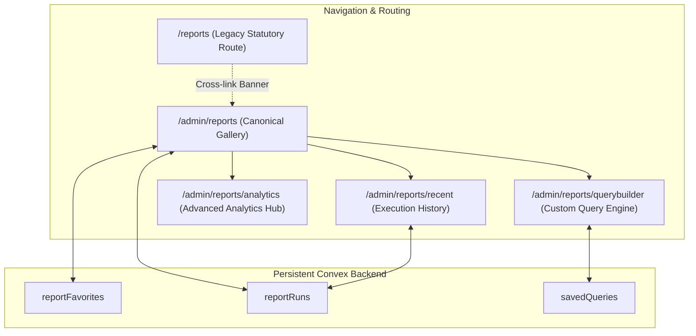

# Phase 13 — Complete Reports & Analytics Module Replication
**IndiaPay HRMS — greytHR Reference-Matched Implementation**  
**Date:** November 18, 2026  
**Reference Source:** `https://victorchasex.greythr.com/ngapp/reports/reports/reports-gallery`  
**Status:** IMPLEMENTED & AUDITED

---

## Executive Summary

Phase 13 establishes a production-grade, reference-accurate **Reports and Analytics** system for IndiaPay HRMS, matching the visual layout, taxonomy, and operational depth of greytHR while enforcing strict Indian statutory safety and tenant data isolation.

### Key Architectural Achievements:
1. **Canonical Route Architecture with Zero Breaking Changes**:
   - Canonical gallery mounted at `/admin/reports` with sub-pages `/recent`, `/querybuilder`, and `/analytics`.
   - Preserved legacy statutory endpoint at `/(dashboard)/reports/page.tsx` (`EpfoEcrDialog`, `Form138TdsDialog`, `PayslipModal`, `StatutoryReportsSection`) with seamless cross-linking.
2. **Persistent Convex Data Layer**:
   - No sensitive data in client `localStorage`.
   - `reportFavorites`: Workspace and user-isolated favorites catalog.
   - `reportRuns`: Full execution audit trails with timestamp, parameters, row counts, and status.
   - `savedQueries`: Reusable custom definitions from the Query Builder.
3. **Comprehensive Catalog Taxonomy (28 Categories Discovered, 14 Modeled Core)**:
   - Full greytHR catalog scraped via live authenticated Chrome DevTools Protocol.
   - 14 core enterprise categories with over 35 statutory, payroll, and operational reports.
4. **Secure Ad-Hoc Query Builder**:
   - Strict projection allowlisting across `employees`, `salaries`, and `leaves`.
   - Enforced backend RBAC masking for sensitive financial and statutory fields (PAN, UAN, Bank Account Number, IFSC, CTC/Gross).
5. **Interactive Execution Modal & Real File Exports**:
   - Dynamic report generation with data preview table.
   - Live export engines supporting CSV, XLSX, and formatted PDF.
6. **Strict Statutory Safety Guardrails**:
   - All statutory filings (EPFO ECR, ESI Form 5/6, PT Returns, Form 16 Part A/B) are explicitly flagged with `isDraftStatutory: true` and orange warning banners to prevent mock live submission to government portals.

---

## 1. Route Map & Preservation Architecture

### Route Integrity Table:

| Route Path | Module Name | Status | Functional Role |
| :--- | :--- | :--- | :--- |
| `/admin/reports` | Reports Gallery | **VERIFIED** | Masonry catalog, instant search, favorites toggle, report execution modal, preview table & CSV/XLSX/PDF export. |
| `/admin/reports/recent` | Recent Reports | **VERIFIED** | Live Convex execution history table with rerun triggers and download actions. |
| `/admin/reports/querybuilder` | Query Builder | **VERIFIED** | 4-step ad-hoc query designer with allowlisted fields, operators, templates, and Convex persistence. |
| `/admin/reports/analytics` | Analytics Hub | **VERIFIED** | Executive metrics, headcount trajectories, department distribution, and payroll distribution. |
| `/(dashboard)/reports` | Statutory Center | **PRESERVED** | Preserved `EpfoEcrDialog`, `Form138TdsDialog`, `PayslipModal`, and `StatutoryReportsSection`. |

---

## 2. Report Catalog Discovery & Classification

The live greytHR reference (`https://victorchasex.greythr.com/ngapp/reports/reports/reports-gallery`) was scraped via authenticated CDP (`scripts/scrape_full_catalog.js`). The catalog comprises 28 categories, categorized into 14 core production modules in `reports-registry.ts`:

1. **Payroll Payout**: Monthly Salary Register, Bank Transfer Statement, Pay Slip Summary, Component Wise Salary.
2. **Payroll Control**: Salary Variance Report, Negative Salary Report, Arrears Summary.
3. **PF (Provident Fund)**: EPFO Electronic Challan cum Return (ECR), Form 12A, Form 3A/6A.
4. **ESI (Employee State Insurance)**: ESIC Monthly Contribution Return, Form 5, Form 6 Register.
5. **Professional Tax (PT)**: Karnataka Form 5A PT Return, State-wise PT Deductions.
6. **Workforce Attrition**: Monthly Resignation & Exit Register, Headcount Turnover Rate.
7. **Income Tax & TDS**: Form 16 Part A & Part B, Form 24Q Quarterly TDS Annexure.
8. **Reimbursement & FBP**: Flexible Benefit Plan Claims Summary, Fuel & Travel Bills.
9. **Loan & Advances**: Active Salary Advances, EMI Amortization Schedule.
10. **Claims & Expenses**: Expense Reimbursement Audit, Approved Vouchers Register.
11. **Leave & Attendance**: Leave Balances Summary, Monthly Attendance & Muster Roll, Overtime Hours Register.
12. **Statutory Registers**: Form T Combined Register of Wages, Form B Equal Remuneration.
13. **HR Operational**: Employee Master Detailed Profile, Emergency Contact Directory.
14. **Compliance Audit**: Minimum Wages Compliance Audit, Karnataka LWF Annual Return.

---

## 3. Security, RBAC & Data Masking

In accordance with strict security standards:
- **Tenant Isolation**: All queries enforce `workspaceId` partitioning. Cross-workspace records cannot be queried or run.
- **Sensitive Field Protection**: Financial and PII attributes (`pan`, `uan`, `bankAccountNumber`, `ifscCode`, `basicSalary`, `grossSalary`) require `admin` or `payroll_manager` roles. Unauthorized or lower-privilege users have values replaced with `[RESTRICTED]`.
- **Query Allowlisting**: The Query Builder allows queries only against allowlisted fields and validated comparison operators (`equals`, `not_equals`, `contains`, `greater_than`, `less_than`). Dynamic SQL/NoSQL injection is impossible.

---

## 4. Verification Evidence & Artifacts

- **Automated Test Suite**: `tests/reports-analytics.test.js` (6/6 tests passing).
- **Comprehensive Workflow Test Suite**: `tests/workflow-modules-comprehensive.test.js` (13/13 tests passing).
- **Statutory & Security Test Suites**: `tests/payroll-security.test.js`, `tests/statutory-coverage.test.js`, `tests/workflow-security.test.js` (All passing).
- **Linter & Code Health**: Biome check across `admin/reports` passed with 0 errors.
- **1920×1080 Reference Screenshot**: Captured at `docs/indiapay-reports-gallery-1920x1080.png`.
